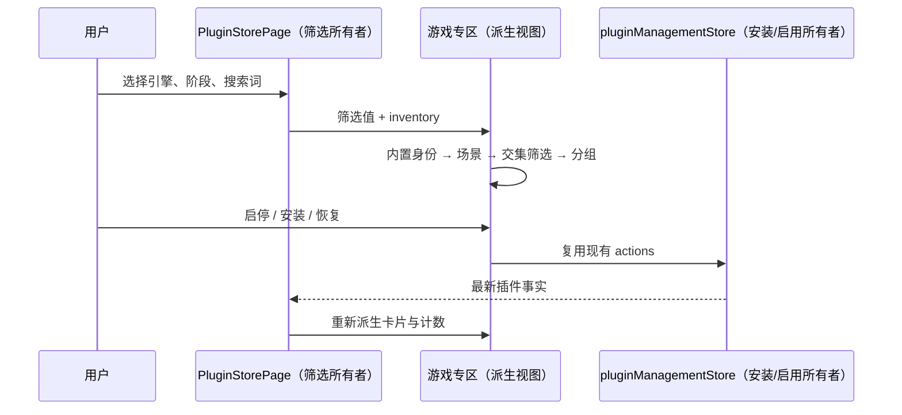

# 游戏开发插件专区

## 产品规则与布局

- 保留插件市场页头、搜索、通用/个人列表及管理入口，在同一分段栏新增「游戏开发」。专区是内置插件的场景投影，不是新的安装来源。
- 桌面：左侧引擎筛选，中间插件卡片；顶部以单一紧凑横栏并排展示「游戏开发」标题、内置插件标记和阶段筛选按钮（含全部阶段）。移除可见的「生命周期」前缀文字与图标，简介只保留给辅助技术，不再单独占一行；筛选组保留无障碍名称。点击直接切换，使用 aria-pressed 表达选中态；空间不足时自然换行，不使用下拉菜单。窄屏：引擎与阶段均为可换行按钮；无横向页面溢出。复用主题、字体、头像及卡片操作。
- 通用分段沿用内部 `public` 标识，仅将用户可见名称改为「通用」（英文 General），不改变列表范围或切换行为。
- 生命周期：新游发现、游戏开发、素材生成、游戏测试、广告集成、游戏发布；引擎：TapTap制造、虚幻引擎、Unity、团结引擎、Godot、Three.js、Cocos Creator。均有「全部」，各维度单选、跨维度取交集。
- 试玩助理属于新游试玩场景，同时标记 `discovery` 和 `testing`，在「新游发现」和「游戏测试」下均可见，仍沿用跨引擎通用能力规则。
- 引擎空数组表示跨引擎的通用能力（如素材生成、黑盒试玩），匹配所有引擎；不等同于支持每个引擎的编辑器集成。非通用插件只匹配明确声明的引擎。
- 专区内搜索与筛选组合，仅查本专区；通用/个人原有跨来源搜索行为保留。显示结果数、载入态、无内容/筛选无结果及一键清除筛选。
- 按明确声明的开源、闭源分组；缺少源码声明的插件直接展示卡片，不显示「源码信息待补充」标题或分组数量，不得由缺少 GitHub URL 推断闭源。左侧引擎列表不显示「游戏引擎」标题，保留筛选组的无障碍名称。开源必须提供安全的 HTTPS GitHub 仓库 URL。卡片右上角展示可点击「开源 · GitHub」banner，调用平台外链端口，点击/键盘操作不触发卡片详情。
- 开源/闭源只说明源码公开情况，与内置、是否启用和付费条件相互独立。不得编造尚未提供的引擎插件；暂无插件的生命周期仍可选择并呈现空态。
- 卡片使用 32px 头像和 16px 水平内边距，标题与两行简介集中在头像右侧，阶段标签在下方换行。底部左侧放启用状态和开关，右侧放更新、菜单或恢复操作，同排卡片底部对齐。卡片区域达到 36rem 时使用双列，否则单列。

## 接口与单一所有者

- `config/official-plugins.json` 是内置插件场景分类的唯一登记源，`listing.gameDevelopment` 声明 `engines`、`stages` 和可选 `source`（`open-source` + `repositoryUrl` 或 `closed-source`）。生成官方契约，不手改生成文件。
- shared 的 `gameDevelopmentPluginListingSchema` 统一提供枚举、严格运行时校验和推导类型；Agent contracts/adapter 通过公开入口复用。旧 listing 无此字段仍有效；畸形扩展字段被 adapter 丢弃，不影响原插件浏览/安装。
- UI 只接受官方内置 marketplace 中有合法场景元数据的完整插件 ID；本地同名条目不能冒用身份进入专区。
- `PluginStorePage` 单独持有专区筛选 UI 状态，返回详情或切换分段保留筛选；退出页面后重置，不写服务端或广播。结果和计数均由 inventory 派生，不建第二份安装状态。
- 插件启停、安装/恢复、更新、卸载沿用现有 `PluginStoreActions` 与 `pluginManagementStore`。本变更不新增远程请求或改变 Desktop/手机传输语义。

## 验收

1. 现有通用/个人页面不变；专区只展示带场景元数据的内置插件，恢复内置条目也可见。
2. 七种引擎、六个阶段、通用能力、搜索交集、清除筛选、空态及筛选保留正确。
3. 「TapTap制造」使用稳定标识 `taptap-maker`；现有 TapTap Maker 插件关联该引擎，同时保留其 Three.js 转写分类；筛选计数与通用能力规则不变。
4. 开源/闭源/未声明分组正确；非法仓库 URL、非枚举引擎/阶段和未知字段不能进入协议。
5. 卡片详情、开关、恢复按钮与 GitHub banner 独立响应鼠标及键盘，不互相误触。
6. E2E 覆盖中文/英文、明暗主题、桌面及 390px 手机布局；检查无页面错误和横向溢出。
7. 1053px 中文桌面视口中，标题与所有阶段按钮处于同一横栏并垂直居中；阶段组没有可见前缀或独立简介行，仍可通过无障碍名称定位。
8. 1053px 视口显示双列，640px 和 390px 视口显示单列。现有三张游戏开发卡片在默认字号下不高于 148px，同行开关与菜单分别靠左、靠右并保持对齐。
