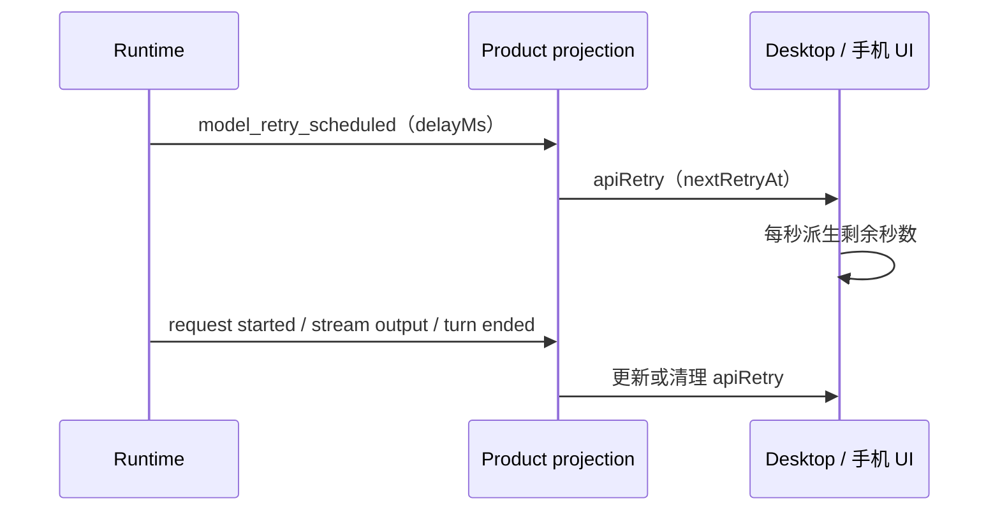

# 模型重试等待反馈

## 规则与所有者

模型请求因网络或 provider 错误进入恢复时，从第一次重试就显示“模型请求重试”及次数；有未来 `nextRetryAt` 时显示真实退避剩余秒数。到点改为正在重试，不能宣称已连接成功；后续请求成功/回合结束后由既有投影清理。普通加载状态不显示倒计时或虚构完成度。

`snapshot.control.apiRetry` 是唯一事实源，runtime 决定重试，product projection 产出 `attempt/maxAttempts/nextRetryAt/reasonCode`。UI 只读取快照、以当前时间派生显示秒数，不发送恢复命令、不写第二份状态、不重放工具。保留既有等待用户操作、compact 等 loading eligibility 判断。

Desktop continuous 与手机 replayable 均使用同一个快照字段；重连快照按绝对 `nextRetryAt` 计算，不能从重连时重新等待一整段退避。计时只影响文字，不影响实际 admission/重试时刻。沿用现有重试展示优先级，不改协议及重试策略，不输出原始错误、端点或凭据。

## 验收

- 第一次 60 秒退避直接可见；秒数随时间减少。
- 到点仍保留重试标记，等待 runtime 后续事实；成功清理后回到普通 loading，结束时消失。
- 快照恢复到退避中途只显示剩余时间；过期快照不显示负数。
- 第三次重试上限仍按 `maxAttempts - 1` 展示；中文、英文及手机宽度可读。
- 浏览器 E2E 使用生产组件与受控时间验证以上过程，不伪造 Blender/模型成功结果。
