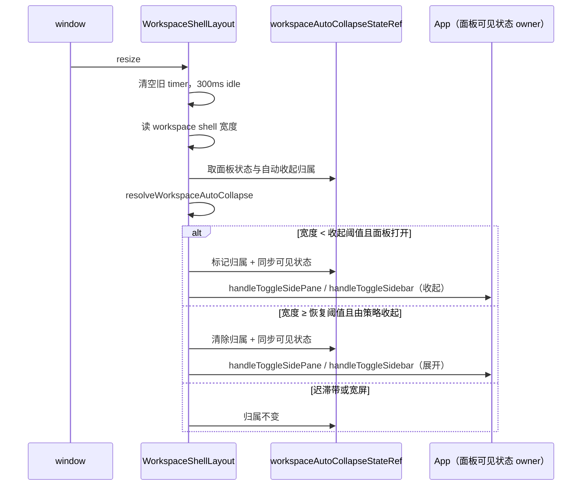

# 工作区自动收起（右侧面板 / 左侧栏）

`WorkspaceShellLayout` 在窗口 resize 后的布局策略：工作区过窄时自动收起右侧面板与左侧栏，
变宽后只自动恢复由本策略收起的面板。判定逻辑与纯函数在
`src/app-shell/workspaceAutoCollapse.ts`，本文件约束交互语义。

## 规则

- **只响应窗口 resize**：`window.resize` 后等待 300ms idle 再判定。面板自身开合、拖拽分割条
  不触发 `resize`，因此不会被当成窗口变窄。不监听 `conversation` 的 `ResizeObserver`，避免
  “打开面板 → 会话变窄 → 被策略关回去”的反馈。
- **按整个工作区宽度判定**：读取 workspace shell 根元素的 `getBoundingClientRect().width`，
  不再读 `conversation` 面板宽度。`conversation` 宽度依赖面板是否打开，会让同一窗口尺寸得到
  两种判定结果。
- **阈值与迟滞**：

  | 面板 | 自动收起 | 自动恢复 |
  |---|---|---|
  | 右侧面板 | 工作区 < 1120px | 工作区 ≥ 1240px（1120 + 120） |
  | 左侧栏 | 工作区 < 640px | 工作区 ≥ 760px（640 + 120） |

  收起阈值沿用原行为换算（右侧面板默认 45%、侧栏默认 264px：原 conversation < 480 约等于
  workspace < 1136；原 conversation < 360 约等于 workspace < 624）。迟滞带内保持现状，
  避免窗口在临界宽度附近抖动时反复开合。
- **自动恢复只看归属**：只有 `sidePaneAutoCollapsed` / `sidebarAutoCollapsed` 为 true 时才自动
  展开。用户手动打开面板会清除对应归属（用户接管）；用户手动关闭也不会被自动展开。切换
  workspace 会清空归属。
- **一次判定、互不依赖**：右侧面板和左侧栏使用同一份宽度同时判定，不再先收起右侧、等待布局
  后再用 `conversation` 宽度判断左侧栏。极窄工作区会在一次事件里同时收起两者。
- `workspaceMainView !== "chat"` 时不判定；工作区宽度不可测（0 或非有限值）时不改变状态。
- toggle 回调是异步 state 更新：调用后同步更新 ref 中的 `isSidePaneOpen` / `isSidebarVisible`，
  防止同一 idle 窗口内的第二个 resize 回调重复 toggle。

## 事件顺序

## 验收

1. 工作区 1119px、右侧面板打开 → 收起；1120–1239px 内再次 resize → 保持收起，不抖动。
2. 同样由策略收起后拉宽到 ≥1240px → 自动展开；用户手动关闭的面板拉宽后保持关闭。
3. 工作区 <640px → 一次事件同时收起右侧面板与左侧栏；拉宽到 ≥760px → 只恢复由策略收起的左侧栏。
4. 面板开合、拖拽分割条不触发自动收起；只有窗口尺寸变化触发。
5. 切换 workspace 后旧归属失效，不会在新工作区自动展开面板。

验证：`pnpm --filter @zcode/ui exec vitest run test/workspaceAutoCollapse.test.ts`。

## 非目标

- 不改变面板可见状态的 owner（仍由 App/既有 store 持有），不新增持久化字段。
- 不改面板默认宽度、最小宽度或 `react-resizable-panels` 的折叠行为。
- 不引入随面板内容变化的自适应判定（例如聊天内容长度、tab 数量）。
