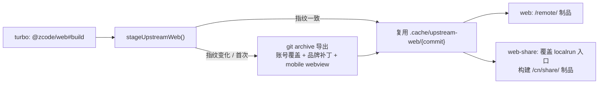

# 分享页构建：复用固定官方源码导出

## 背景与规则

`@zcode/web-share` 是 `/cn/share/<code>` 会话分享页的独立入口，只负责分享页与 OAuth 回调页，不参与 Web 工作台路由。

- 页面主体、share/auth 源码全部来自 `packages/web/upstream-web.json` 固定的官方提交，**不把上游源码复制进产品目录**（与 `packages/web` 的 Web 制品规则一致）。
- 本仓只保留 `packages/web-share/src/main.tsx`（localrun 下禁用官方 OAuth、保留 mock owner 入口）与 `src/ShareAuthPages.tsx` 两个入口覆盖；禁止覆盖分享页业务组件或官方连接逻辑。
- 构建前由 `packages/web/scripts/stage-upstream-web.mjs` 导出到 `.cache/upstream-web/<commit>`，web 与 web-share 共用同一份 stage，避免两份不一致的上游源码。
- stage 以 `.stage-state.json` 记录输入指纹（上游提交、覆盖文件、品牌脚本、仓库内品牌资产、relay origin）。指纹一致时直接复用，不一致时重新导出；多个构建进程通过同级 `.stage-lock` 串行化导出。

## 构建流程

1. `@zcode/web#build` 先执行（`turbo.json` 的 `@zcode/web-share#build` 依赖），由它导出 stage 并构建 `/remote/` 制品。
2. `@zcode/web-share#build` 调用 `stageUpstreamWeb()`；如果 stage 已被 web 构建或上次构建准备好，直接复用。
3. 把本仓 `packages/web-share/src` 覆盖到 stage 的 `packages/web-share/src`。
4. 在 `stage/packages/web-share` 内用仓库锁定的 Vite 构建，产物写入本包 `dist`（`base=/cn/share/`，图标来自官方导出中的 `packages/web/public`）。
5. `pnpm --filter @zcode/web-share dev` 使用同一 stage 启动 Vite dev server；修改入口覆盖文件后需重启 dev server 才会复制到 stage。

## 状态与所有权

| 状态/输入 | 所有者 |
| --- | --- |
| 固定上游提交、覆盖清单 | `packages/web/upstream-web.json` |
| 官方源码导出、品牌补丁、账号适配覆盖 | `packages/web/scripts/stage-upstream-web.mjs` |
| localrun 分享入口覆盖 | `packages/web-share/src` |
| 分享页产物 | `packages/web-share/dist`（git 忽略） |
| 构建顺序 | 根 `turbo.json` |

## 验收

- `pnpm --filter @zcode/web-share run build` 通过，`dist/index.html` 引用 `/cn/share/assets/*`。
- 清理 `.cache/upstream-web` 后单独构建 web-share 能自行完成导出（不依赖 turbo 顺序）。
- 修改 `packages/web-share/src/main.tsx` 后重新构建，产物包含 localrun 文案与 mock owner 入口。
- 指纹不变时重复构建不重新抽取 stage；修改 `upstream-web.json` 或品牌资产后指纹变化并重新导出。
- `/cn/share/<code>` 页面可加载分享时间线、回调页可完成登录；私有分享在 localrun 下显示禁用说明。
