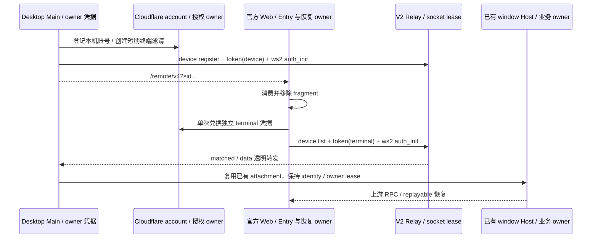
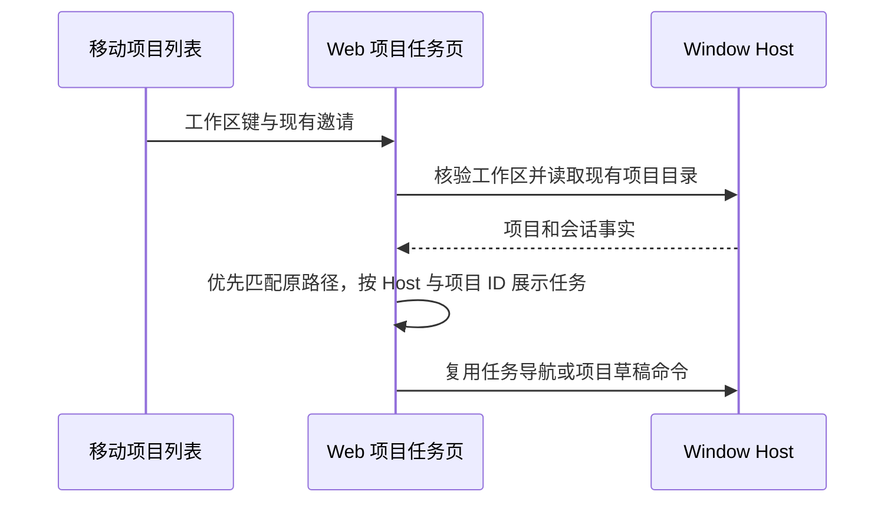
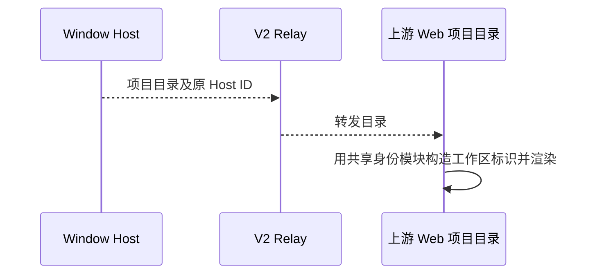

# 官方 Web 与自建 V2 服务

## 许可交付

固定上游导出自带的声明仅表示该快照的材料，不代表本仓实际装配。生产构建后将上游声明保留为 `UPSTREAM-THIRD-PARTY-NOTICES.md`，当前本仓声明复制为 `THIRD-PARTY-NOTICES.md`；HTML 同时提供两个 rel=license 链接。构建读取现有声明，不更新清单、不因开发期 inventory 过期而阻断；缺少任一原文保留 ENOENT。manifest 登记两份声明的 SHA-256，CF 复制同一制品。验收核对实际构建与 CF 公开静态资源中的哈希和链接，不只断言文件存在。

构建导出排除不参与 Web 编译的根 docs 目录，避免 Windows tar 处理上游中文文档路径失败；其余固定源码与工作台哈希验证保持。Vite 通过当前 Node 执行真实 JS 入口，不执行平台专用的 .bin shell shim，支持 Windows 及含空格的仓库路径。

Web 制品直接构建官方 ZCode 固定提交的 packages/web、packages/ui 及其源码依赖，不能再以本仓 RelayApp、RelayComposer 或裁剪后的 Root 拼接移动工作台。固定提交记录在 upstream-web.json，本次采用已验收的 3.17.2；不更新全仓 UPSTREAM_BASE。构建导出到忽略的缓存目录，不把上游桌面、旧 CUA 或营销服务接回本地产品运行时。

页面、设备列表、项目与会话导航、输入、工具、附件、终端及断线恢复均以上游 Web 为准。允许替换产品部署配置、账号适配器和下述纯品牌展示，构建记录上游提交与全部覆盖文件。禁止对上游工作台行为或连接逻辑打补丁来迁就旧 Relay。

## Web 品牌资产适配

品牌母版仍由 `assets/brand/kayingcode.png` 唯一维护；Web 构建复用现有派生的 KayingCode mark、app badge、empty-state 和 favicon，不修改模型供应商的 Z.ai 等独立商标。

- HTML 首屏在 JS / 授权请求之前内联 KY 图像和 favicon，React 初始化继续显示同一 KY 标识；跨工作区整页跳转也不能闪回 ZCode。
- 连接前页头、小应用图标、About 字标及聊天首页深浅主题水印使用同一品牌资源族。水印沿用上游布局、问候语与主题切换；浅色反色、深色淡化，避免影响正文可读性。
- 构建仅可替换明确列出的品牌叶子函数、品牌模块和标题/页头字面量；禁止全局字符串替换、运行时 DOM / title 观察器或改写连接状态。上游函数签名和调用面保持不变。
- 构建 manifest 同时记录原始工作台哈希、品牌适配文件前后哈希与资产来源哈希；未知上游结构必须构建失败，不能静默遗漏 Logo。
- 验收覆盖 JS 尚未加载的首屏、React loading、连接页和聊天首页深浅主题，以及手机/桌面布局；检查原业务函数未变、供应商标识未变、同源静态路径和实际构建输出。

品牌验收（2026-11-06）：Web 单测 4 项、原品牌资产测试 6 项通过；`branding.e2e.mjs` 通过 JS 前首屏、React loading、连接标识、390/1180px 与手动深浅主题（不依赖系统主题），浏览器运行错误 0。根 typecheck/source/architecture 通过，Lint 0 errors、127 个既有 warnings。已发布 Cloudflare 版本 `770686e7-d749-4e6e-8987-f7a9b18b5838`；生产 `/remote/v4` 返回 200，内嵌 KY 与品牌 manifest 均匹配最终构建。连接后的品牌页面通过本地实际导出组件验证，生产匿名入口另做运行检查；未再次占用用户终端连接。

“与上游 Web 功能对齐”指 Host/服务端提供上游页面调用的全部频道、方法与事件，而不是修改页面源码：项目按 hostId 路由、远端项目连接状态、attachment 的 project/remote-project/task-group 频道、controller host scope 与任务动作、终端 owner、窗口项目活动以及 agent hello 能力均由 Host 接线保证。具体规则见 packages/services/spec/upstream-project-controller-parity.md 与 packages/desktop/spec/mobile-web-remote.md。

采用上游 /api/v1/remote/device、device/delete、token、ws2 V2 契约；桌面复用已有 WebRemoteControlManager 与 window-scoped Host attachment。Relay 只保存账号授权、设备登记、短期 token、presence 和 socket 配对，不存任务、快照或队列。CommandInbox 是 accepted 输入唯一 owner；桌面 continuous 与手机 replayable 保持现有语义。

没有官方账号服务，因此 Cloudflare 增加轻量授权服务：桌面在本机持久化私有 owner 凭据，生成一次性、五分钟有效的终端邀请；邀请秘密只进入 URL fragment。浏览器先消费并清除 fragment，经同源账号端口兑换独立终端凭据，再把 Bearer 端口交给原封不动的上游 Entry。owner 凭据不可交给手机；过期、重复领取、跨账号 SID 和被撤销凭据必须拒绝。未授权访问提示重新从桌面扫码，不能跳官方 OAuth 或伪造 JWT。

socket 换代关闭同角色旧连接；旧连接 close 不得清掉新 lease。one-time token 在 upgrade 时原子消费，并绑定账号和角色；auth_init 只允许已登记且同账号的 SID。设备断线不重放 data；重连由上游 client generation/recovery 执行。

Taro / Flutter 对此入口只做链接解析、可信 origin 校验、Web 容器与生命周期，不 claim 旧 Node Relay ticket，不另建会话连接。旧自有 Web 工作台从交付链路删除；不兼容旧二维码。其他 Bot、审核体验、Provider 与管理 API 不属于本次删除范围。

验收：制品 manifest 标明官方 commit 和全部覆盖文件；V2 schema、鉴权、跨账号、错角色、重放和过期测试；socket 转发、换代及恢复集成；真实浏览器从桌面扫码进入官方页面并读取已有会话、刷新与切换项目；Taro/Flutter 容器测试；根 typecheck/lint/source/architecture 与实际部署。未执行项如实记录。

首发验收必须点击真实发送按钮，检查新任务进入目录、草稿提升到对话、回复显示和刷新后恢复；只打开 composer 不算发送验证。CLI 事实写入与恢复规则见 `packages/services/spec/remote-first-send-task-facts.md`。`test/firstSend.e2e.mjs` 使用专用已授权浏览器的 `REMOTE_FIRST_SEND_CDP`，只发送无工具 QA 指令并归档它创建的任务。

## 验证记录（2026-11-05）

- `webAuthService` 3 项通过：邀请 fragment 先清理再 claim、浏览器持有独立 terminal token、邀请失效时保留既有会话。
- `packages/web/dist/mobile-web-manifest.json` 记录固定官方提交、核心工作台哈希、适配器哈希与锁文件哈希。
- 本地 Wrangler 同源托管验证：`/remote/v4` 返回 200 HTML 且无重定向、manifest 200、`/v1/client-config` 声明 V2 并保持 `webClientUrl=null`、匿名 device API 401。
- Taro H5 容器 E2E 6 个场景通过（320/375px、深浅色、v1/v2 入口、刷新与错误恢复）。
- 真实 Desktop dev + 生产 V2 + 官方 Web（390×844）通过：授权、已有任务、新建任务 composer、项目选择切换与跨项目打开任务均正常；未发送消息，测试浏览器凭据已注销。
- 未执行：独立手机真机；官方 Web 整链已在桌面 dev + 手机尺寸浏览器上验证。

## 功能对齐记录（2026-11-05）

官方 Web 源码与 override 白名单未变；本轮只补 Host/服务端能力：项目按 hostId 路由、远端项目连接状态与重连、远端 attachment 的 project 频道、controller host scope/getTaskMeta/rename、窗口项目活动叠加、终端 owner、agent hello 能力。详见 `packages/services/spec/upstream-project-controller-parity.md` 与 `packages/desktop/spec/mobile-web-remote.md`。

验证：`pnpm --filter @zcode/web build` 通过并重新生成 manifest；`pnpm --dir apps/kayingcode-relay-cloudflare run build:web` 与 relay 测试通过（20 pass / 5 skip，skip 需本地 origin）。真实 Desktop 扫码后的发送消息与远端项目切换待整链复验。

## 移动容器项目导航例外（2026-11-07）

经产品确认，允许在固定上游 main 的成功 renderExternalRelayRoot 边界调用纯元数据通知，并在首次 bootstrap 通过现有 preferredWorkspaceKey 参数接收外壳项目导航。此为此前“禁止工作台行为补丁”的限定例外：不修改业务命令、状态所有者、鉴权、socket、恢复与 UI。构建通过唯一锚点及 SHA256 记录适配，未知上游结构直接失败。

事件为 `{type:"kayingcode.project-opened.v1", workspacePath, workspaceIdentity?}`；只在当前有效 bridge 成功后发送，不包含邀请、token、task、lease 或 remoteSessionId。H5 使用指定 parent origin 与 source 校验；微信通过 wx.miniProgram.postMessage（按平台在返回时送达）；Flutter 使用原生 JS channel / WebView2 message。最近项目按设备及 identity/path 隔离，历史仅作导航提示，必须由 Host 重新核验。目标已关闭时显示失败，不静默打开别的项目。

## 从项目入口查看任务会话

移动容器的 `kayingShell=1` 与 `kayingWorkspace` 同时存在时，Web 用该工作区进入项目任务页。允许在固定上游 Web 的工作区切换接口和侧栏入口增加此限定展示分支。普通扫码和设备入口继续使用原有工作台。首次加载仍由 Host 核验工作区；指定键保留在 URL，打开同项目其他根目录的任务后返回列表仍聚焦原项目。

项目目录由现有 Host 与 `ProjectDirectoryProvider` 提供，按 Host 和项目 ID 展示该项目可读取的所有任务会话，包含置顶和归档，沿用现有分页与任务导航。没有正式项目登记时，仅显示同一工作区的未归类任务。不同 Host 的同路径和不同项目的任务不能混入。Windows 本地根路径优先匹配 Host 验证过的原始路径，仅无精确匹配时按正反斜杠兼容已有记录。精确路径或兼容路径匹配出多个项目时，提示项目归属冲突并暂停新建；窗口关闭提示只用于 Host 判定的窗口关闭。目录加载完成且无任务时展示「新建任务」，已有任务时同样保留项目内新建入口。新建正式项目任务使用现有 Host 项目草稿流程，未登记的工作区复用该工作区的草稿入口。

验收覆盖有任务、空项目、独立工作区、跨根目录、同路径不同 Host、Windows 正反斜杠存量项目并存、精确路径冲突、归档和置顶、读取失败与点击新建。桌面 continuous 与 Web replayable 继续由原有 Host 路径交付。

### 移动项目任务列表的呈现

仅显式项目入口使用双行任务卡。页头保留项目名和新建入口，目录成功加载时展示当前项目任务总数。首行显示标题与原有任务状态，次行复用时间线行的目录、来源（有时）、相对更新时间与可用变更摘要。任务卡增加行间距、边界和触控高度。深浅主题使用现有设计 token。未读、置顶、归档及操作仍经既有任务行；顺序、分页、工作区归属、路由和数据来源保持原语义。未能读取目录时显示原错误。

网页的返回箭头负责返回任务目录，移动容器以关闭操作退出整页。Web 不接管原生路由或浏览器容器，继续拥有会话导航历史。验收包含 320px、390px、深浅主题、跨目录打开后返回同一项目、空态和新建。

### Flutter 底栏呈现

仅 `kayingShell=1&kayingPlatform=flutter` 启用 Flutter 移动导航。即使容器宽于普通手机断点，也复用 Web 现有列表与聊天导航。Web 导航所有者在已提交的页面变化后，经 `KayingNavigation` 或 WebView2 消息发送 `{type:"kayingcode.mobile-page.v1", page:"browse"|"agent"}`。事件只包含呈现状态，Agent 草稿与已有对话均为 `agent`。Flutter 用当前路由的事件决定底栏可见性。首次未收到消息、导航到新文档或主页面加载失败时，Flutter 显示底栏。普通 Web、Taro、Host 状态及回放链路沿用既有入口。

同文档内退出工作台时，卸载的页面会报告 `browse`，以便重新进入设备选择或连接提示时恢复底栏。验收覆盖项目任务列表、打开任务、网页返回、新建草稿、浏览器刷新后恢复对话、同文档退出，以及非 Flutter 入口不发送事件。

## 远程 Agent 项目标识兼容

固定上游 Web 的项目目录会从 Host 的 `hostId` 和项目根目录构造工作区标识。上游 3.17.2 只解析 `remote:`，本产品 Host 已发布 `remote-agent:` 目录记录，导致 Web 在项目目录渲染阶段抛出 `Invalid remote host identity`。允许在固定上游导出中以产品共享的纯工作区标识模块及其类型依赖替换这一身份边界。远程 Agent 标识的构造和解析统一由共享身份模块维护，保留 `server-remote` 的公开导出。构建校验被替换的上游文件哈希，拒绝覆盖未知版本，并把适配文件的前后哈希计入 manifest 与 staging 缓存校验。

Host 仍是项目目录、工作区归属和连接的唯一权威。Web 使用原 Host ID，路径编码与桌面相同，保留现有 SSH、WSL、Docker、Source Server 和非法标识校验。存量目录及标识无需迁移。V2 Relay 继续透明转发，`desktop-continuous` 与 `web-remote-replayable` 的交付、lease 及重连沿用现有流程。

验收覆盖两类 Server 标识、含中文或保留字符的目录、非法 Host ID、未知上游源码、实际 Web 构建及 390px 浏览器从配对连接渲染含存量远程 Agent 项目的目录。

本地验证通过 Web 及共享身份回归测试、Relay 静态产物构建和 390px Chromium 项目目录渲染。浏览器使用固定上游导出的项目目录组件和模拟 Host，确认离线缓存项目可见，Controller 收到完整编码的工作区标识，页面无运行异常。真实终端重新配对和生产部署待验证。
